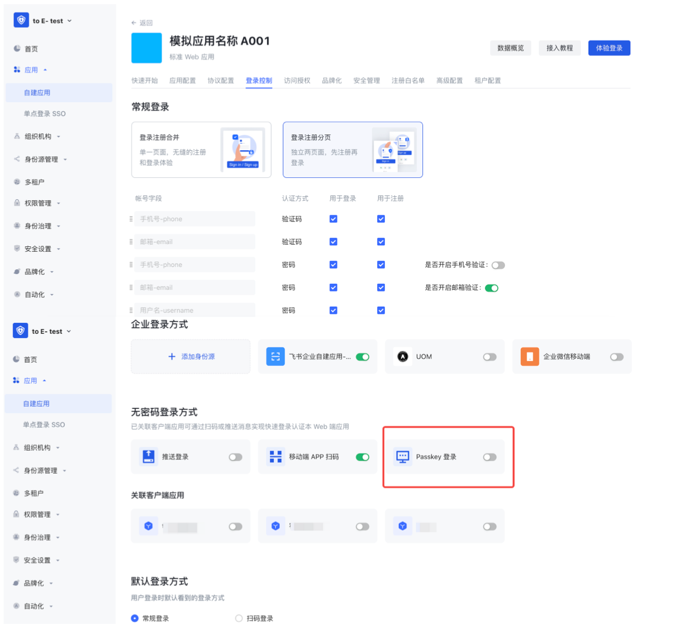
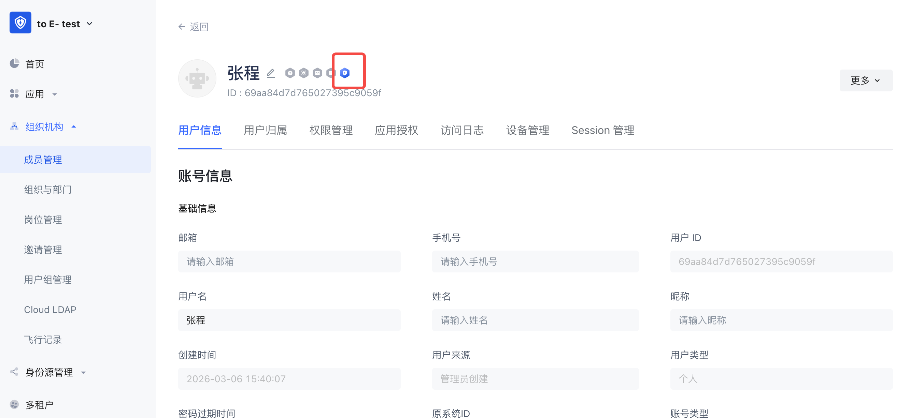
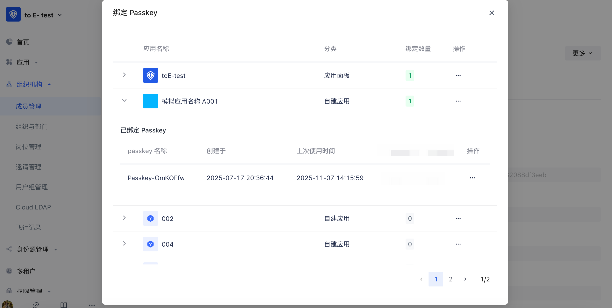
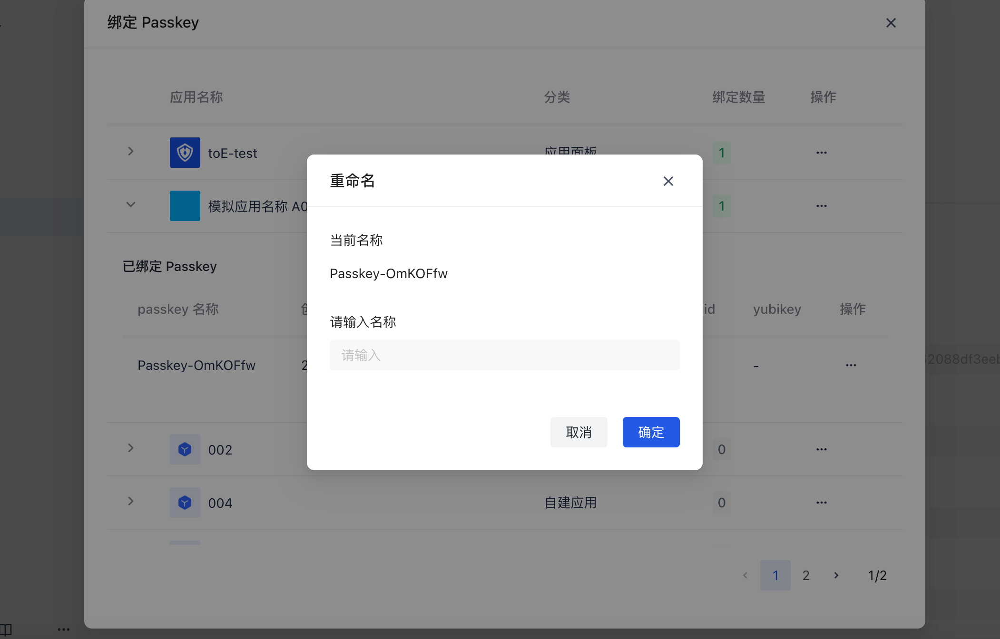
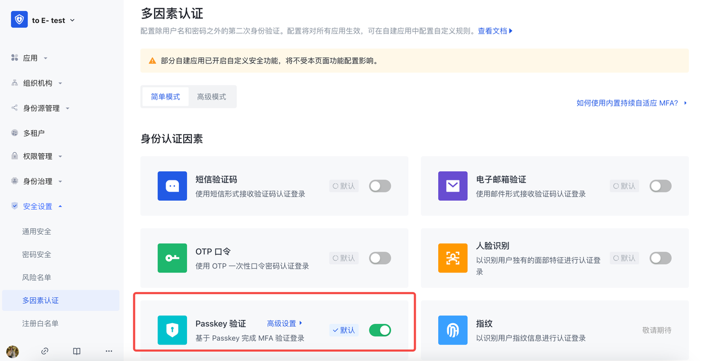
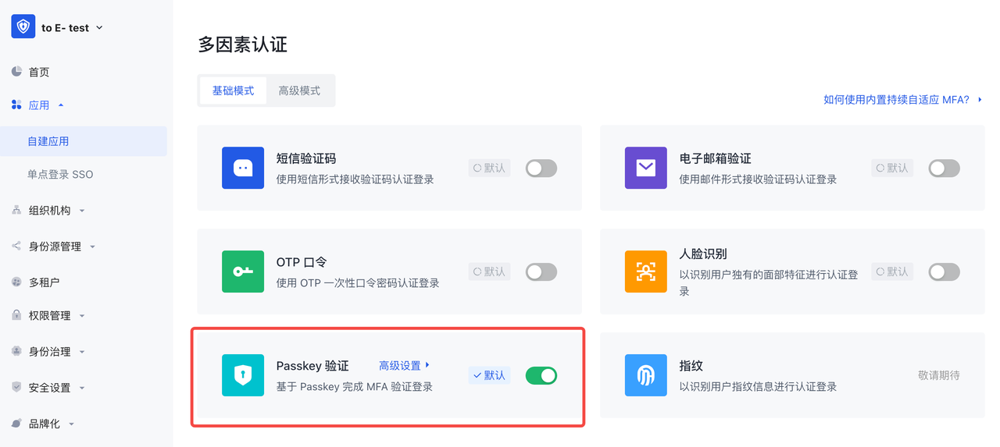
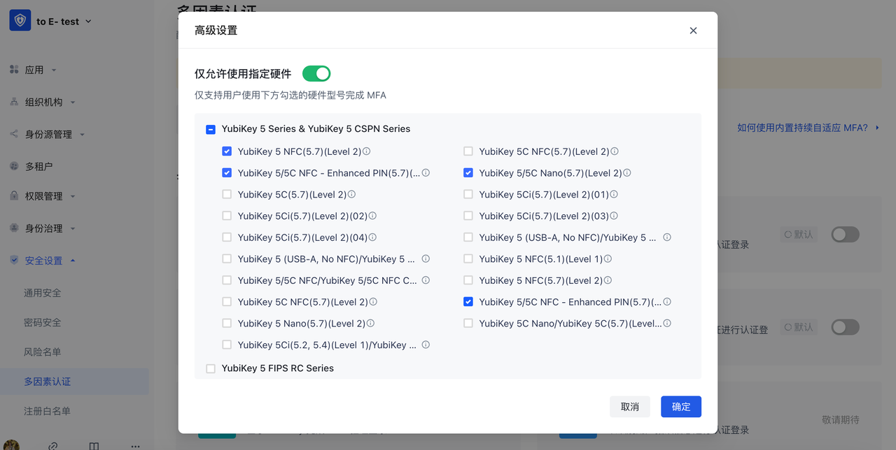
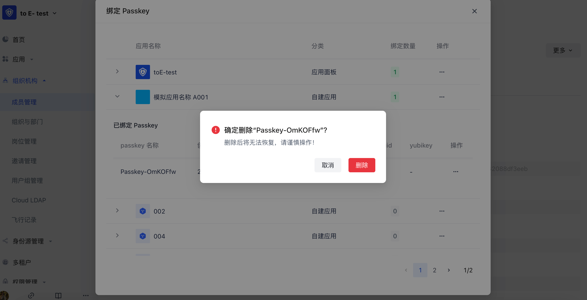

# Passkey 的启用与管理

<LastUpdated/>

## 1. 使用 Passkey 登录

**Passkey** 是一种基于 **FIDO2/WebAuthn 标准** 的无密码登录方式，通过设备本地的生物识别或设备 PIN 完成身份验证，例如：指纹识别、面容识别、Yubikeys、设备解锁 PIN...

相比传统密码登录，Passkey 具有以下优势：

| **特性** | **说明**            |
| ------ | ----------------- |
| 无密码登录  | 用户无需记忆密码          |
| 防钓鱼    | 密钥与域名绑定，无法被钓鱼网站利用 |
| 高安全性   | 基于公私钥加密           |
| 用户体验好  | 只需指纹/面容即可登录       |

在 Authing，Passkey 可以作为一种登录方式使用，用户可直接通过设备完成登录认证。

### 1.1 使用前准备

启用 Passkey 登录前，需要确保：

1. 应用已接入 Authing。
2. 用户使用支持 Passkey 的设备和浏览器。

### 1.2 开启 Passkey 登录

1. 登录 Authing 控制台。
2. 进入自建应用，打开「登录控制」页，开启「Passkey 登录」并保存应用配置。

### 1.3 管理 Passkey

管理员可以在控制台对用户的 Passkey 进行管理，支持以下操作：

| **操作**      | **说明**                                  | **图示**                                                                                                                                                                 |
| --- | --- | --- |
| 查看 Passkey | 管理员可以查看用户已绑定的 Passkey，可见创建时间、最近使用时间等信息。 |  |
| 重命名 Passkey | 管理员可以为用户重命名 Passkey，便于识别和管理。 |  |
| 删除 Passkey | 管理员可以移除用户的 Passkey。 |  |

## 2. 使用 Passkey 多因素认证（MFA）

### 2.1 使用前准备

启用 Passkey 进行多因素认证前，需要确保：

1. 应用已接入 Authing。
2. 用户使用支持 Passkey 的浏览器或设备。

### 2.2 开启多因素认证中的 Passkey

1. 登录 Authing 控制台。
2. 开启「Passkey 验证」。

   * 进入安全设置 - 多因素认证 >  开启「Passkey 验证」> 高级设置中配置硬件型号白名单（如需）

   > 针对未开启应用【高级设置-安全规则】的应用

* 进入自建应用 > 打开「安全管理」页 > 开启「Passkey 验证」> 高级设置中配置硬件型号白名单（如需）

> 针对开启了【高级设置-安全规则】的自建应用

* 配置 Passkey 硬件型号白名单，目前已支持部分型号的 Yubikey 可选：

### 2.3 管理 Passkey

管理员可以在控制台对用户的 Passkey 进行管理，支持以下操作：

| **操作**      | **说明**                                  | **图示**                                                                                                                                                                 |
| --- | --- | --- |
| 查看 Passkey | 管理员可以查看用户已绑定的 Passkey，可见创建时间、最近使用时间等信息。 |  |
| 重命名 Passkey | 管理员可以为用户重命名 Passkey，便于识别和管理。 |  |
| 删除 Passkey | 管理员可以移除用户的 Passkey。 |  |

## 3. 常见问题

* **用户更换设备怎么办？旧的 Passkey 还能用吗？**

旧的不能继续使用，用户需要在新设备上重新创建 Passkey。

1. 当在同一应用下绑定新的 passkey 后，旧的 passkey 则不能再使用。
2. 当用户发现旧的 passkey 不能使用时，绑定新的 passKey 即可。

* **Passkey 会泄露吗？**

不会。

由于 Passkey 基于公私钥机制，即：私钥仅存储在用户的设备中，服务器只保存公钥。所以即使服务器泄露，也依然无法伪造登录。
