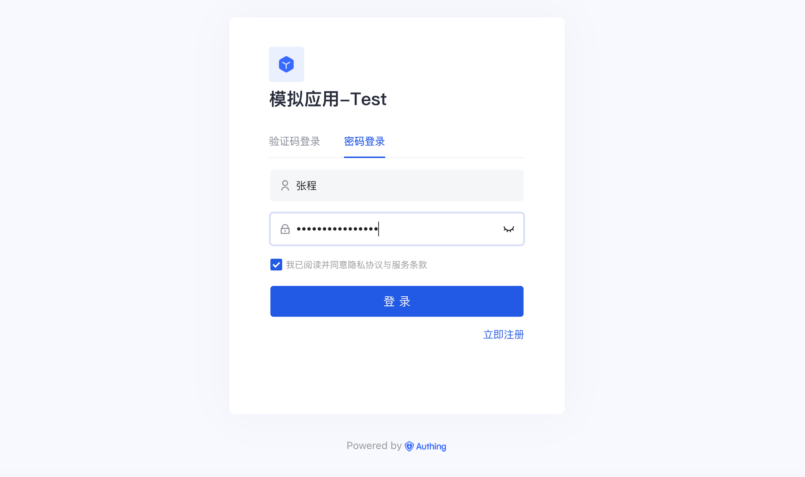
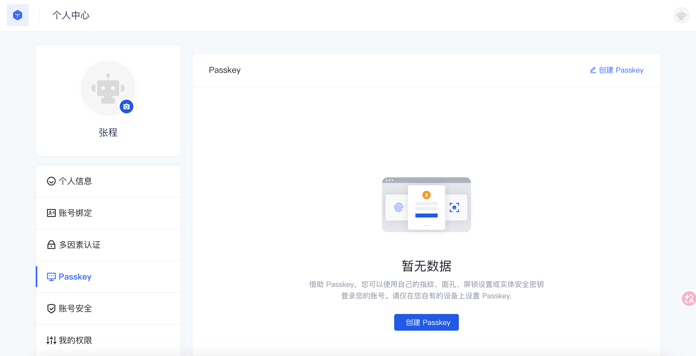
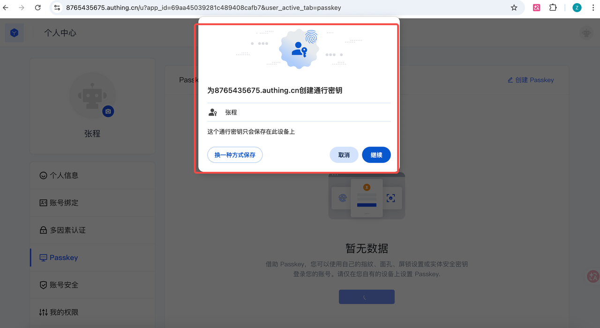
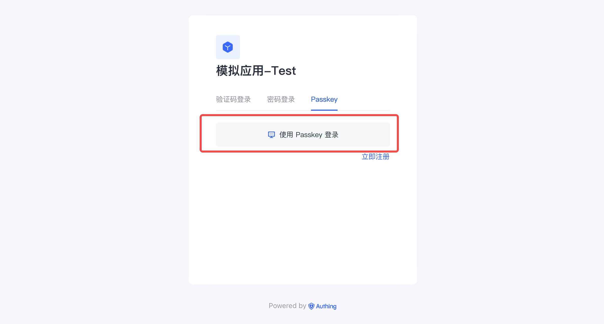
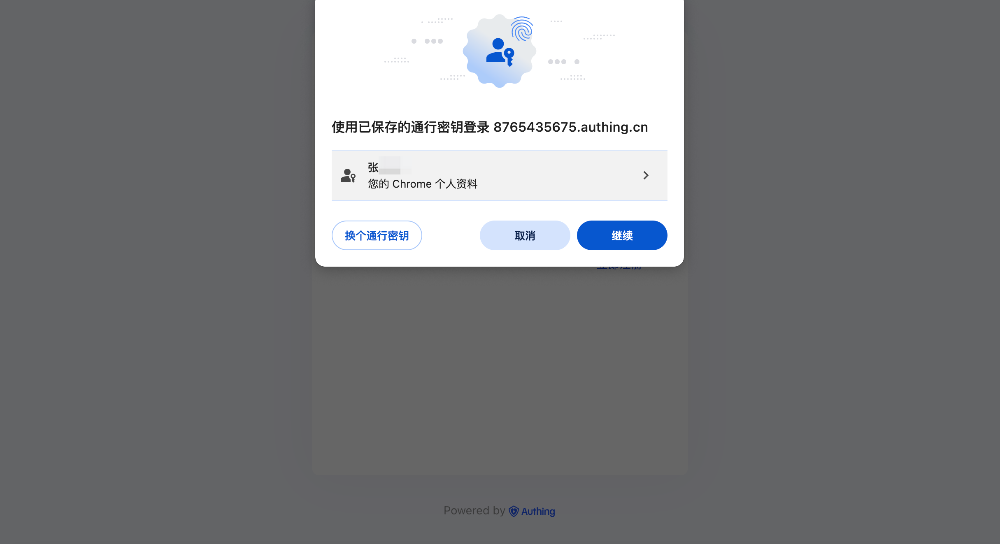
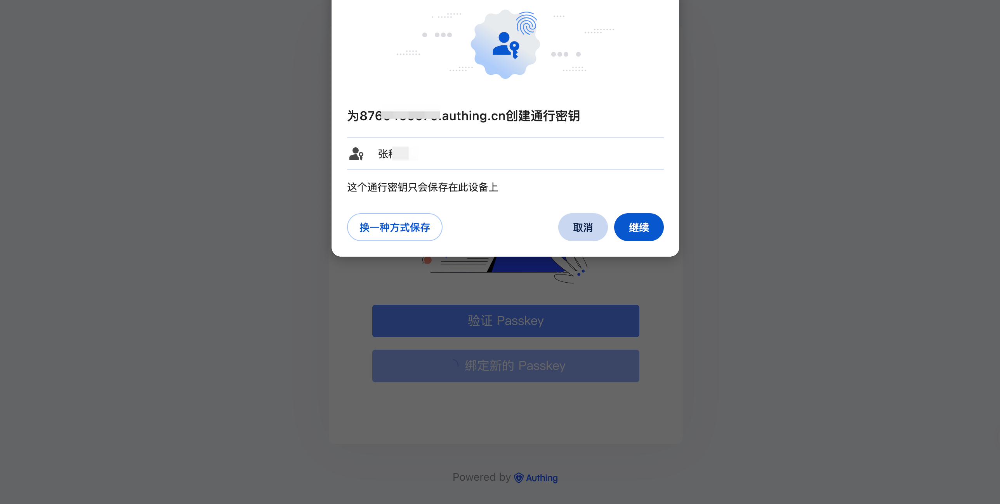
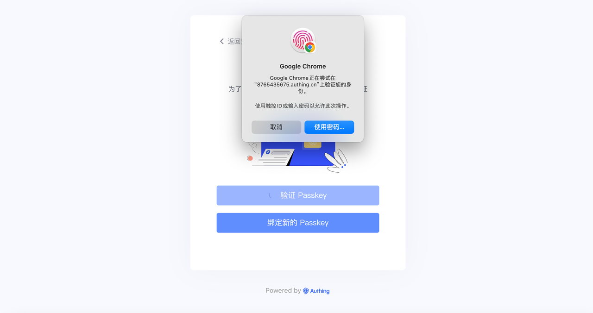

# 终端用户如何使用 Passkey？

<LastUpdated/>

**Passkey** 是一种基于 **FIDO2/WebAuthn 标准** 的无密码登录方式，通过设备本地的生物识别或设备 PIN 完成身份验证，例如：指纹识别、面容识别、Yubikeys、设备解锁 PIN...

相比传统密码登录，Passkey 具有以下优势：

| **特性** | **说明**            |
| ------ | ----------------- |
| 无密码登录  | 用户无需记忆密码          |
| 防钓鱼    | 密钥与域名绑定，无法被钓鱼网站利用 |
| 高安全性   | 基于公私钥加密           |
| 用户体验好  | 只需指纹/面容等即可登录      |

在 Authing，Passkey 可以作为一种登录方式使用，用户可直接通过设备完成登录认证。

# 1. 使用 Passkey 登录

前提条件：管理员已开启 Passkey 登录功能。

## 1.1 使用其它方式登录

若想要给您的账号创建 Passkey，需要先使用其他登录方式完成登录，进入应用后，前往个人中心进行相关配置；

* 如图，使用密码登录等方式，完成第一步登录：

## 1.2 创建 Passkey

当应用开启 Passkey 登录后，用户即可在登录后，从该应用进入「个人中心」创建并绑定 Passkey：

* 点击【创建 Passkey】：

* 根据浏览器提示步骤完成创建即可；

## 1.3 Passkey 登录

1. 在登录时，选择【Passkey 登录】方式：

2. 根据浏览器指引，选择您需要的 passkey 类型进行验证即可：

### 1.4 管理 Passkey

用户可以前往「个人中心-Passkey」查看和管理 Passkey，操作如：重命名、删除等。

## 2. 使用 Passkey 多因素认证

前提条件：管理员已开启多因素认证的 Passkey 功能。

### 2.1 绑定 Passkey

1. 完成第一步登录，例如：密码登录。

2. 系统提示进行 MFA - Passkey 绑定：

* 绑定后，未来即可在登录触发多因素认证后，使用 Passkey 进行验证；

### 2.2 验证 Passkey

1. 完成第一步登录，例如：密码登录。

2. 系统提示进行 MFA - Passkey 验证。

* 用户根据浏览器弹出的相关指引进行验证即可；

### 2.3 管理 Passkey

用户可以前往「个人中心-Passkey」查看和管理 Passkey，操作如：重命名、删除等。

## 3. 常见问题

### Passkey 会泄露吗？

不会。

由于 Passkey 基于公私钥机制，即：私钥仅存储在用户的设备中，服务器只保存公钥。所以即使服务器泄露，也依然无法伪造登录。

### 用户更换设备怎么办？旧的 Passkey 还能用吗？

旧的不能继续使用，用户需要在新设备上重新创建 Passkey。

1. 当在同一应用、同一设备下绑定新的 passkey 后，旧的 passkey 则不能再使用。
2. 当用户发现旧的 passkey 不能使用时，绑定新的 passKey 即可。

### 如何在设备上彻底移除 Passkey？

如果您需要取消某台设备的自动登录权限，或更换了生物识别设备，可以按照以下说明在对应的操作系统或浏览器中移除已存储的 Passkey。

1. 浏览器内置存储（Chrome / Edge）
- 如果您在登录时选择了将 Passkey 保存在浏览器中：
- Chrome：地址栏输入 `chrome://settings/passkeys`
- Edge：地址栏输入 `edge://settings/passkeys`
- 找到目标网站，删除 Passkey 即可。
2. Apple 设备（macOS / iOS / iPadOS）
- Apple 将 Passkey 存储在 iCloud 钥匙串中。
- 打开系统设置 > 密码，在列表中找到对应的 Authing 域名，点击“i”详情图标 > 编辑 > 删除通行密钥。
3. Windows 设备
- Windows 会使用 Windows Hello 管理通行密钥。
- 打开设置（Win + I）> 账户 > 通行密钥，在搜索框中输入 Authing 相关域名，点击条目旁边的“...” > 删除通行密钥。

注意事项：

- 同步删除：在 iCloud 或 Google 账号中删除 Passkey 后，所有登录该账号的同步设备都将无法再使用该密钥。
- 账户权限：移除本地 Passkey 不等于停用 Authing 账户。建议在移除前，仔细检查是否有其他登录密钥或方式。
